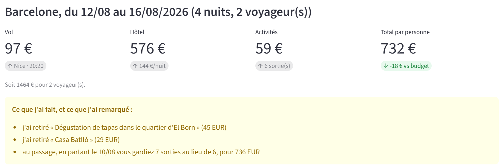
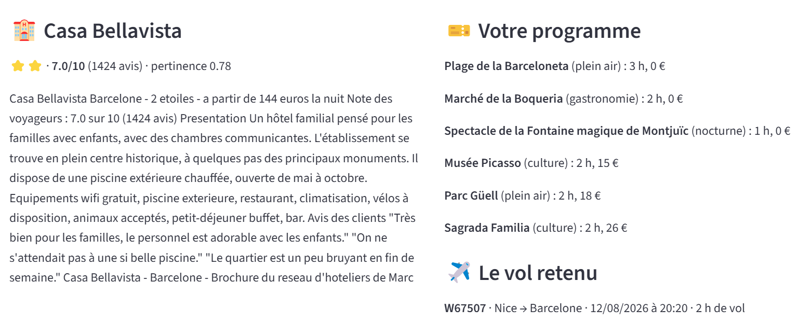

# Projet 07 : Un agent IA qui planifie des vacances

Un agent de voyage qui compose vol + hôtel + activités dans un budget,
se rattrape quand ça ne rentre pas, explique ses choix et peut réserver,
avec une interface web Streamlit.

## Objectif
À partir d'une demande (destination, dates, budget par personne, envie libre),
proposer un voyage complet et expliquer chaque décision. Le tout **sans LLM** :
un agent, c'est avant tout une boucle (objectif → outil → évaluation → correction).

## Les trois outils
- **Vols** : requête SQL paramétrée (`?`, pour éviter l'injection SQL), triée par prix
- **Activités** : requête SQL, de la moins chère à la plus chère
- **Hôtels** : recherche sémantique par embeddings sur 135 brochures PDF
  (similarité cosinus sur la présentation et les avis, pas sur les équipements
  communs à tous les hôtels)

## La boucle de l'agent
Plan idéal : vol le moins cher, hôtel le plus pertinent, toutes les activités.
Tant que le budget est dépassé :
1. retirer l'activité **payante** la plus chère (inutile de retirer du gratuit)
2. sinon, descendre vers un hôtel moins cher
3. sinon, renoncer sans rien promettre

L'agent explore aussi les jours voisins (±2 jours) et **signale** un meilleur plan
sans jamais déplacer les dates lui-même. Chaque ajustement est écrit dans un journal
généré par le code, donc toujours exact.

## Résultats
| Demande | Résultat |
|---|---|
| Barcelone, 4 nuits, 2 voyageurs, 750 EUR/pers | **732 EUR/pers** (vol 97 + hôtel 576 + activités 59), soit 1 464 EUR au total |
| Hôtel choisi | Casa Bellavista (hôtel familial avec piscine, pertinence 0,78) |
| Sacrifices | 2 activités payantes retirées (tapas à El Born 45 EUR, Casa Batlló 29 EUR) |
| Bon plan repéré | partir le 10/08 : 7 sorties au lieu de 6, pour 736 EUR |
| Budget 660 EUR | rien ne rentre le 12 août, mais l'agent repère un jour voisin possible |
| Budget 200 EUR | aucune solution : l'agent ne promet rien |

La réservation est protégée par un garde-fou : sans confirmation explicite,
rien n'est écrit dans la base.

## Application web
Interface Streamlit (`app.py`) : formulaire (destination, voyageurs, dates, budget,
envie), résultat chiffré, journal de l'agent et bouton de réservation.

```bash
streamlit run app.py
```




## Ce que j'ai retenu
- Un agent, ce sont ses **outils** et sa capacité à se rattraper, pas un modèle de langage.
- L'ordre des sacrifices (activités d'abord, hôtel ensuite) est un choix de conception,
  pas une vérité : il est discutable et il faut pouvoir le défendre.
- Quand une recherche échoue, l'élargir d'un cran coûte peu et rapporte beaucoup.

## Limites
- Les embeddings ne comprennent pas la négation (« sans enfant »)
- Le plan sacrifie toutes les activités avant de changer d'hôtel, sans les remettre ensuite
- La demande passe par des champs de formulaire, pas par du texte libre

## Technologies
Python, SQLite, pandas, sentence-transformers, Streamlit, Jupyter

## Fichiers
- `projet_07.ipynb` : notebook complet
- `agent.py` : l'agent, généré depuis le notebook
- `app.py` : interface web
- `utils.py` : fonctions utilitaires
- `data/` : base SQL (vols, activités) et brochures d'hôtels

## Pour aller plus loin
Intégrer un LLM (Qwen) pour lire une demande en langage libre et gérer la négation,
remettre des activités au programme après un changement d'hôtel,
ajouter la ville de départ comme critère.

## Crédit
Projet issu du Cahier de Vacances 2026 de [Machine Learnia](https://www.youtube.com/@MachineLearnia).
Exercices complétés par moi-même.